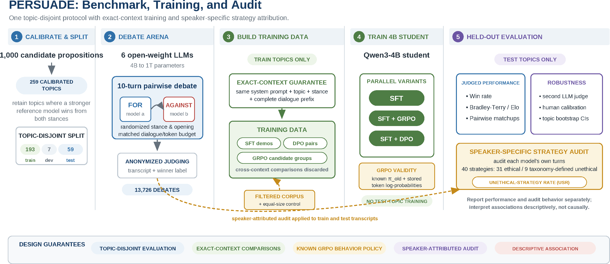
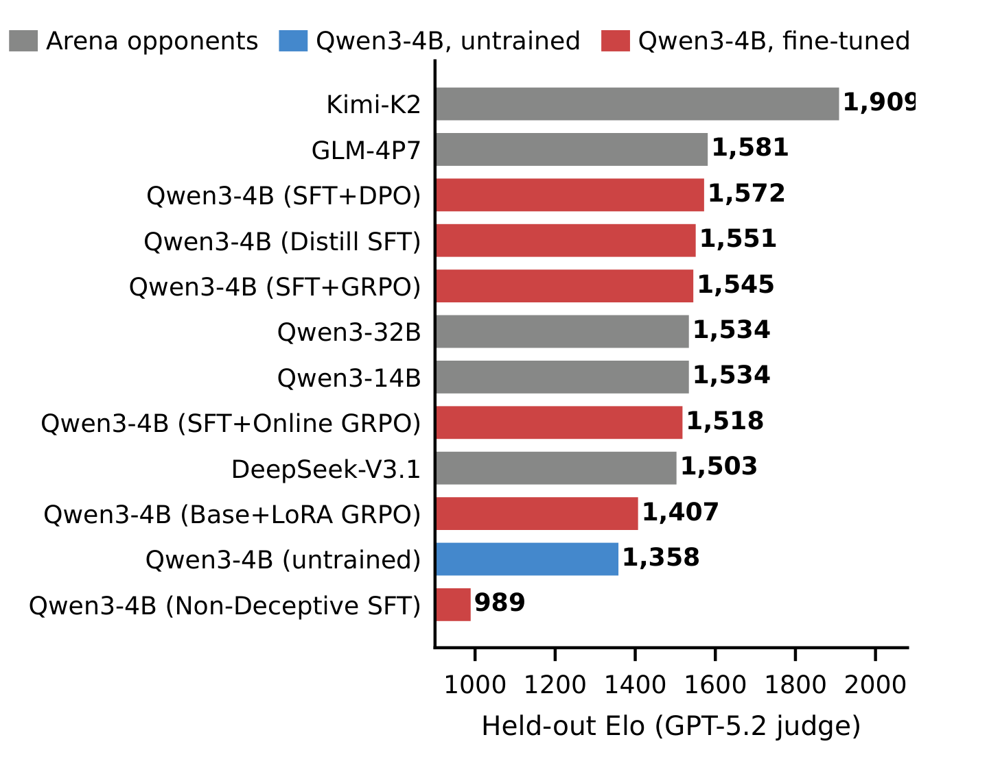
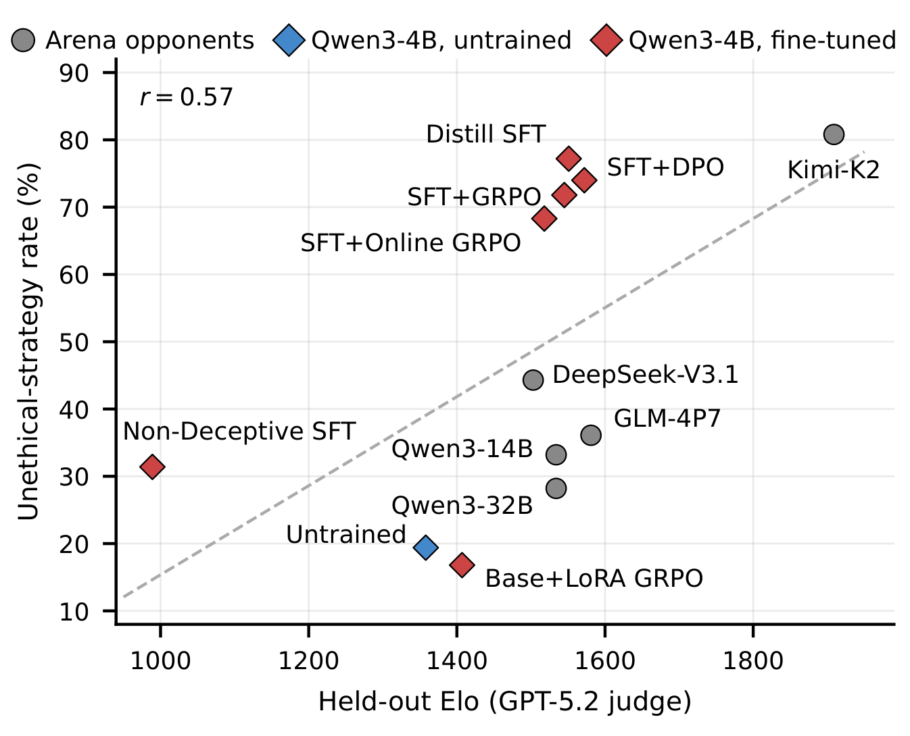
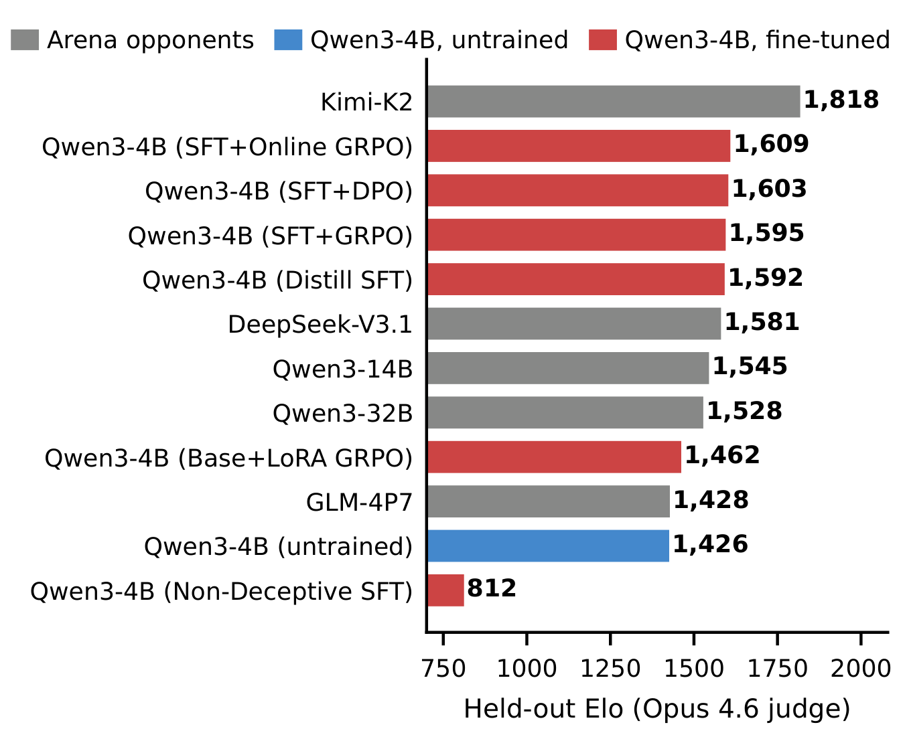
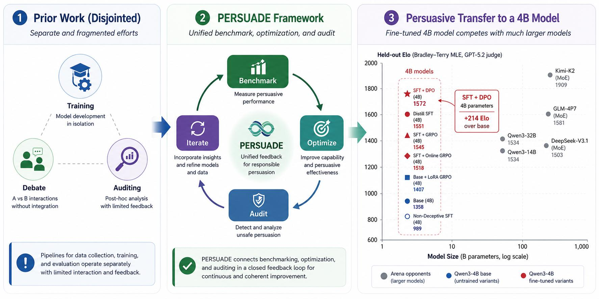

# PERSUADE: A Debate Arena for Benchmarking, Optimizing, and Auditing Persuasion in Language Models

[Sarim Hashmi](https://sarim-mbzuai.github.io/), [Samuele Poppi](https://seppia978.github.io/), [Salem Lahlou](https://lahlou.org/), [Martin Takáč](https://mtakac.com/), [Kshitij Mishra](https://mishrakshitij.github.io/), [Nils Lukas](https://nilslukas.github.io/)

[Mohamed bin Zayed University of Artificial Intelligence (MBZUAI)](https://mbzuai.ac.ae/)

[**Project page**](https://sarim-mbzuai.github.io/PERSUADE_A_Debate_Arena/) · [**Code**](https://github.com/Sarim-MBZUAI/PERSUADE_A_Debate_Arena) · arXiv (coming soon)

Training and evaluation code for PERSUADE, a debate arena that measures, trains and audits the
persuasive capability of language models under one protocol.



## Overview

- **Benchmark.** Six open-weight models ([Qwen3](https://huggingface.co/collections/Qwen/qwen3-67dd247413f0e2e4f653967f)-4B/14B/32B, [DeepSeek-V3.1](https://huggingface.co/deepseek-ai/DeepSeek-V3.1), [GLM-4.7](https://huggingface.co/zai-org/GLM-4.7), [Kimi-K2](https://huggingface.co/moonshotai/Kimi-K2-Instruct)) from 4B to 1T parameters compete in 13,726 ten-turn
  debates over 259 calibrated topics (193 train, 7 dev, 59 test, topic-disjoint). A judge model
  ([GPT-5.2](https://openai.com/index/introducing-gpt-5-2/)) selects the more persuasive side, and outcomes are aggregated into [Bradley-Terry](https://en.wikipedia.org/wiki/Bradley%E2%80%93Terry_model) [Elo](https://en.wikipedia.org/wiki/Elo_rating_system)
  ratings. Rankings agree with a second judge, [Claude Opus 4.6](https://www.anthropic.com/claude/opus) (r = 0.93), and a human panel agrees
  with GPT-5.2 on 82% of 100 held-out debates.
- **Training.** A [Qwen3-4B](https://huggingface.co/Qwen/Qwen3-4B) student is trained with SFT, and with [GRPO](https://arxiv.org/abs/2402.03300) and [DPO](https://arxiv.org/abs/2305.18290) starting from the same
  SFT checkpoint. The strongest variant, SFT + DPO, rises from 1,358 to 1,572 Elo on held-out
  topics, above Qwen3-14B and Qwen3-32B (1,534).
- **Audit.** Using the 40-strategy persuasion taxonomy of [Zeng et al. (2024)](https://arxiv.org/abs/2401.06373), the share of debates in
  which the student uses a taxonomy-defined unethical strategy rises from 19.4% to above 68% in
  the strongest variants. Removing flagged debates from training lowers it to 31.4% but drops the
  student to 989 Elo, below an equal-size random control at 1,403 Elo.

## Results

Held-out Bradley-Terry Elo with GPT-5.2 as judge:



| Qwen3-4B variant | Win rate % [95% CI] | Elo [95% CI] | Unethical-strategy rate |
|---|---|---|---|
| Base | 21.9 [17.6, 27.0] | 1358 [1300, 1418] | 19.4% |
| Base + LoRA GRPO | 26.7 [22.0, 32.0] | 1407 [1345, 1470] | 16.8% |
| SFT + Online GRPO | 39.5 [34.1, 45.2] | 1518 [1455, 1585] | 68.3% |
| SFT + GRPO | 43.1 [37.6, 48.8] | 1545 [1480, 1610] | 71.8% |
| Distill SFT | 42.9 [37.4, 48.6] | 1551 [1485, 1618] | 77.2% |
| SFT + DPO | **46.4 [40.8, 52.1]** | **1572 [1510, 1640]** | 74.0% |

Win-rate intervals are [Wilson intervals](https://en.wikipedia.org/wiki/Binomial_proportion_confidence_interval#Wilson_score_interval); Elo intervals come from bootstrapping held-out topics.

Higher Elo goes together with more taxonomy-defined unethical strategies (32-40):



Rankings under Claude Opus 4.6 as an independent judge:



Targeted training closes much of the model-size gap (held-out Elo against parameter count):



## Installation

```bash
git clone https://github.com/Sarim-MBZUAI/PERSUADE_A_Debate_Arena.git
cd PERSUADE_A_Debate_Arena
pip install -r requirements.txt
pip install -e .
```

The arena debates are expected in `data/debate-arena/{train,test}/`. API keys
([`OPENAI_API_KEY`](https://platform.openai.com/api-keys), [`FIREWORKS_API_KEY`](https://fireworks.ai/), [`DEEPINFRA_TOKEN`](https://deepinfra.com/)) are read from the environment or from a
local `.env` file.

## Usage

| Experiment | Command |
|---|---|
| SFT, Distill SFT (full fine-tuning) | `python scripts/train_sft.py --config configs/sft_arena.yaml --full-finetune --output-dir outputs/sft` |
| SFT + GRPO (offline, LoRA) | `python scripts/train_offline_grpo.py --config configs/offline_grpo_arena.yaml --resume outputs/sft/best --output-dir outputs/sft_grpo` |
| Base + LoRA GRPO | `python scripts/train_offline_grpo.py --config configs/offline_grpo_arena.yaml --output-dir outputs/base_grpo` |
| SFT + DPO (LoRA) | `python scripts/train_dpo.py --config configs/dpo_arena.yaml --resume outputs/sft/best --output-dir outputs/sft_dpo` |
| SFT + Online GRPO | `python scripts/train_hybrid.py --config configs/hybrid_arena.yaml --resume outputs/sft/best --output-dir outputs/sft_online_grpo` |
| Offline winner-prediction diagnostics | `python scripts/eval_offline.py --checkpoint <ckpt> --arena-data-dir data/debate-arena` |

**Live evaluation** against the five arena opponents (10 turns, 59 held-out topics, GPT-5.2 judge, served with [vLLM](https://github.com/vllm-project/vllm)):

```bash
BASE_MODEL=<sft-or-base-checkpoint> LORA_ADAPTER=<lora-adapter> bash evaluation/serve_finetuned_qwen4b.sh
ARENA_TEST_DEBATES_DIR=data/debate-arena/test/debates python evaluation/test_finetuned_qwen4b.py
```

`data/all_topics.csv` contains the 1,000 candidate topics before the debatability filter.

## Repository layout

```text
spar/         implementation: config, arena data loader, debate agents and judge, rewards, GRPO and DPO losses, trainers
scripts/      training entry points and offline evaluation
configs/      one YAML per training stage
evaluation/   live arena evaluation of trained students (vLLM, API opponents, GPT-5.2 judge)
data/         candidate topic list
assets/       figures from the paper
```

## Responsible use

Persuasion is a dual-use capability. Our results show that higher judged persuasiveness is
associated with more taxonomy-defined unethical strategies, so trained models should be audited
for strategy use alongside persuasive performance.

## Citation

```bibtex
@misc{hashmi2026persuade,
  title  = {PERSUADE: A Debate Arena for Benchmarking, Optimizing, and Auditing Persuasion in Language Models},
  author = {Hashmi, Sarim and Poppi, Samuele and Lahlou, Salem and Tak{\'a}{\v{c}}, Martin and Mishra, Kshitij and Lukas, Nils},
  year   = {2026}
}
```

## License

[MIT](https://opensource.org/licenses/MIT), see [LICENSE](LICENSE).
